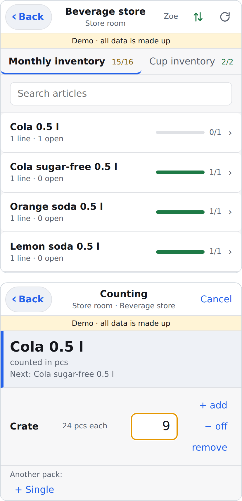
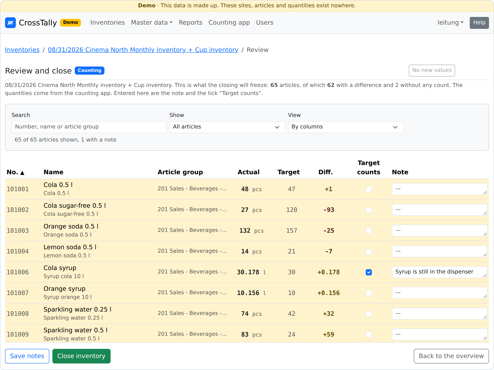

# CrossTally

*[Deutsche Fassung](README.md)*

[](https://github.com/lennago/crosstally/actions/workflows/image.yml)
[](https://github.com/lennago/crosstally/actions/workflows/audit.yml)
[](https://github.com/lennago/crosstally/releases)
[](LICENSE)

Count, review and record stocktakes. It is made for businesses
with several **sites**, that is, locations that keep their goods in a
merchandise management system. Sites, areas, locations and articles are data,
and none of it sits in the code. It fits anywhere several locations maintain
the same article master data separately. A site without such a system, a
restaurant for instance, carries its own articles without numbers and maintains
its target stock by hand.

The first supported format is that of **Compeso WinTICKET**, a point-of-sale
and merchandise management system for cinemas. Further formats come as modules.

The application does not replace the merchandise management system. Valuation,
posting and the binding difference stay there. The application delivers what is
missing while counting: a counting interface for the phone that also works in
the store room without a network, a review list with target stock, actual and
difference while counting is still going on, and in the end an immutable result
as a PDF from which the figures can be transferred to the merchandise
management system.

**Status:** versions are published as
[releases](https://github.com/lennago/crosstally/releases), starting with 0.1.0.
Until 1.0 a breaking change is announced only in the changelog, not by the first
digit of the number.

<p align="center">
  
  
</p>
<p align="center"><em>On the left the counting app in the beverage store, on the right
the review list of the same inventory while counting is still going on. Both come
from the demo.</em></p>

## What it can do

- **Counting with a phone:** an installable web app (PWA) under `/app/`, on any
  smartphone or tablet, with no app store. Offline first: every entry lands on
  the device and goes to the server once there is a network again. Counting goes
  location by location, in the order of the shelf.
- **Packs and scales:** a pack is the packaging a product comes in (crate,
  carton, sack). “9 crates of 20 and 9 singles” or “2750 g in the 250 g bowl”
  are one entry each. Conversion happens on the server, with each container's
  own tare.
- **One article master across all sites:** the same product has a different
  number at every site, and the same number means something different from site
  to site. The application therefore keeps the article of the site (*article*)
  and the goods behind it (*product*) apart and reports across sites, a site
  without a merchandise management system included. If something was created
  twice at the same site, the two are merged: one stays as it is, the other is
  counted towards it, including its target stock.
- **Inventory types as tabs:** monthly and annual inventory, say, or a count of
  its own just for consumables such as cups and bags (at a cinema, the cup
  inventory). Every article belongs to one type, an inventory counts the chosen
  ones, and the counting app shows a tab per type.
- **Import from the merchandise management system:** the article master per
  site, in two steps. First comes a plan to look over, then the writing. Today
  in the format of WinTICKET, as xlsx or csv. The target stock comes as a file
  for the individual inventory or is maintained by hand.
- **Prepared items:** prepared goods that exist in no article master, a ready
  portion of nachos for instance, are counted as a portion and, on closing,
  spread over their ingredients.
- **Review before closing:** differences, notes per article and questions about
  what the count reveals about the master data (inactive but counted, or
  expected but found nowhere). The review list is in the counting app too. Where
  the count cannot be right, a manager sets “Target counts”: on closing, the
  target stock then counts as the result.
- **Difference by hand:** without a file with the target stock, the difference
  is entered per article, as the merchandise management system shows it once
  the counted quantities are in. This works on the website and in the app.
- **Result as a PDF** per inventory, with the notes, and a report across
  periods and sites, grouped by freely chosen product families. Opposing
  differences of the same product show that it has moved between the sites.
- **Roles:** administrators, managers (web interface) and counters (counting
  app only), each assigned to sites and inventories. New accounts come in by
  invitation mail and set their own password. Signing in also works with a
  passkey (face, finger or PIN of the device), on the website and in the app.
- **German and English:** every account chooses its language, for the web
  interface, the administration and the counting app. Article and site names
  stay as they are entered.
- **Also:** encrypted backups from the interface and by script, help texts on
  every page, a light and a dark theme.

**What it cannot do:** there is no interface to the merchandise management
system. The exchange runs through files, and the counted quantities are entered
there by hand. Purchasing, goods receipt, transfers and turnover figures are not
part of the application.

## Why, when WinTICKET exists?

Compeso itself offers a merchandise management system with stocktaking and
mobile counting,
as well as dashboards that report across several sites. This application starts
where that does not work out in practice.

**Sites whose master data have drifted apart.** Whoever runs several sites as
separate Compeso customers rarely has a uniform article master after a few
years. The same product sits under different numbers, and the article groups
are cut differently at each site. Cross-site reports, though, presuppose
uniform master data. Here a shared product links the articles of the sites,
without anything having to be changed in WinTICKET. The import suggests the
assignment, and it is decided once. Grouping follows your own *product
families*, independent of the article groups.

**Counting from a list, without EANs or labels.** The counting app shows, per
location, what is expected there, with a suggested value. You walk the list
from top to bottom instead of searching for and scanning every packet, and
whatever is missing stays visibly open. The article master that WinTICKET
exports anyway is all it needs.

What WinTICKET has over this: its stocktake posts directly into the merchandise
management system. Here the results are transferred from the PDF into WinTICKET.

## How a stocktake runs

1. **Master data, once:** create sites with areas and locations, import the
   article master per site and assemble the count list per location (which
   goods usually lie here, in which pack).
2. **Preparation:** create the inventory (first the inventory types, then one
   site or several), assign the counters, upload the target stock or maintain it
   by hand.
3. **Counting:** “Start counting” releases the inventory to the counting app.
   The web interface shows progress and differences, counting happens only in
   the app.
4. **Review and close:** go through the review list, answer the questions,
   close. The result is frozen afterwards, and the PDF is fed from it.

## Trying it out

One command creates an invented dataset to try everything out on: four sites, four accounts, a product catalogue with count lists and 14
inventories on seven cut-off dates, closed, being counted and in preparation.
You need what “Developing” lists.

```bash
cd server
cp .env.example .env                     # enter SECRET_KEY and ADMIN_URL
uv sync && uv run manage.py migrate
uv run manage.py demo                    # builds the data and prints the accounts
(cd ../app && npm ci && npm run build)   # the counting app, Django serves it under /app/
uv run manage.py runserver               # http://localhost:8000
```

The website is then at `http://localhost:8000`, the counting app
at `http://localhost:8000/app/`. The command `demo` prints the password of the
accounts, and counting works best as `zaehler`. An English interface comes
with `LANGUAGE_CODE=en` in the `.env`, and then the demo is English as well.

The demo writes into the database from `DATABASE_URL` and refuses if there is
already data of your own in it, even a single account. What there is to see, and how to set up a site from
scratch, is described in [DEMO.en.md](DEMO.en.md).

## Structure

| Part | Technology | Where |
| --- | --- | --- |
| Web interface and administration | Python 3.14, Django 6.1, Bootstrap 5.3, PostgreSQL | [server/](server/) |
| Interface of the counting app | Django REST Framework, JWT | [server/api/](server/api/) |
| Counting app (PWA) | Svelte 5, Vite, Dexie (IndexedDB) | [app/](app/) |
| Operation | one image (Django serves the app along with it), Caddy for TLS | [compose.yaml](compose.yaml), [Dockerfile](Dockerfile) |

The data model is available as an ER diagram in
[inventur_datenmodell.en.mermaid](inventur_datenmodell.en.mermaid), in German in
[inventur_datenmodell.mermaid](inventur_datenmodell.mermaid).

## Running it with Docker

Published versions are available as an image under `ghcr.io/lennago/crosstally`
(`linux/amd64` only). You need:

- **A machine** with Docker and the Compose plugin (version 2). It may be small:
  two cores, 2 GB of memory and an SSD are enough.
- **HTTPS.** It is mandatory for the counting app, because without a secure
  context there is no service worker, and therefore neither installation nor
  offline operation. With a domain of your own, Caddy fetches the certificate
  itself. For that the name has to point to the machine in the DNS, and ports
  80 and 443 have to be reachable from the internet (firewall, forwarding in the
  router). If the machine is only in the internal network,
  [DEPLOYMENT.en.md](DEPLOYMENT.en.md#the-certificate) describes the options.

```bash
# 1. Fetch the repository. What is needed from it are compose.yaml, Caddyfile
#    and the backup script. Nothing is built.
git clone https://github.com/lennago/crosstally.git && cd crosstally

# 2. Fill in the environment, see the table below.
cp .env.example .env

# 3. The folder for the backups belongs to the container's user (uid 1000).
mkdir -p backups && sudo chown 1000:1000 backups

# 4. Pull the image and start. '--no-build' matters: the compose.yaml also holds
#    build instructions, and without that flag compose builds the image itself.
docker compose pull
docker compose up -d --no-build

# 5. The first account is an administrator. All others are created in the interface.
docker compose exec web python manage.py createsuperuser
```

The database is migrated automatically on start. After that, sign in, create the
locations under **Master data → Sites and locations** and import the article
master per site. The counting app lives at `https://<address>/app/`.

### What goes into the `.env`

The template explains every value. These belong in every installation:

| Variable | Meaning |
| --- | --- |
| `SECRET_KEY` | **Required.** Long and random, for instance from `openssl rand -base64 48`. |
| `BACKUP_KEY` | **Required.** The key every backup is encrypted with, made the same way. A copy belongs in a place away from the machine: without it no backup can be read any more. |
| `POSTGRES_PASSWORD` | **Required.** The password of the database, made the same way. The database takes it at its first start. |
| `ADMIN_URL` | **Required.** The path of the administration (Django admin), one of your own ending in `/`, for example `verwaltung-x7/`. With the placeholder from the template the application does not start. If you are not signed in, the path answers 404: sign in on the website first, then “Administration” in the account menu leads there. Under `/admin/` only a decoy is waiting. |
| `SITE_ADDRESS` | **Required.** Your own domain, for example `crosstally.example.de`. Caddy fetches the certificate for it itself. `:80` only goes in if something in front already handles TLS. |
| `EXTRA_ALLOWED_HOSTS` | **Required.** The same name. Without it the application answers with “Bad Request”. |
| `CSRF_TRUSTED_ORIGINS` | Recommended: the same address with `https://` in front. Behind Caddy, forms work without it. The entry is only needed when a proxy on the way changes scheme or name. |
| `VERSION` | Which image runs, best a fixed number such as `0.1.0`. Then the entry decides what runs, not the moment of the last `pull`. The template names the latest version. |

The other values have defaults: a mail server for invitations and “Forgot your
password?”, a proxy in front of Caddy, HSTS, language and time zone, the number
of workers. They are described in full in
[DEPLOYMENT.en.md](DEPLOYMENT.en.md#all-values-of-the-env), as are your own
proxy instead of Caddy and a fork with your own image. Name, logo, operator,
legal notice, privacy text and the texts of the mails do not belong in
the `.env`. They are set in the administration (see below).

### Updating

```bash
./server/bin/backup.sh             # a backup first, because migrations run on start
git pull                           # compose.yaml and Caddyfile may change too
# Raise VERSION in the .env, then:
docker compose pull
docker compose up -d --no-build
```

Do not roll out while counting is going on. What has changed between versions
is described with the
[releases](https://github.com/lennago/crosstally/releases) and in the changelog
(`CHANGELOG.md`). A break that requires
manual work in operation is listed there at the top and highlighted. Which
version is running is shown at the very bottom of the account menu, in the web
interface and in the counting app alike. The counting app on the phones notices
a new version by itself and offers to reload.

**More on operation** is in [DEPLOYMENT.en.md](DEPLOYMENT.en.md): all values of
the file `.env`, the certificate without public reachability, backups and
restoring, on a new machine too, the way back after an update and what easily
goes wrong.

## Operator and privacy

The footer of every page states who operates the application, and next to it a
link to the privacy page (`/datenschutz/`, on an English server `/privacy/`).
That page explains to your own people what is stored about them and for how
long. It can be read without signing in, because it concerns the counters above
all, and they otherwise never see the web interface. Operator, contact, a legal
notice, an address for feedback and the privacy text are entered by an
administrator in the administration, in the same version as the logo. The
supplied text is a start, not legal advice. There is neither tracking nor
statistics, the page loads nothing from outside servers, and no cookie banner
is needed. The details are in
[DEPLOYMENT.en.md](DEPLOYMENT.en.md#operator-and-privacy).

## Your own logo

The supplied logo is a placeholder (a tally mark made of pure geometry) and is
meant to be replaced. Replacing it happens in the administration, not through a
fork:

1. Sign in as an administrator.
2. Open **Organisation → Appearance and operator** in the administration. There
   sits the version **Default**: the supplied logo, no operator, no legal
   notice, the supplied privacy text. It cannot be changed, only copied: tick
   the row, action **Create a copy**.
3. Open the copy, give it a name and upload a **square PNG**, at least
   512 x 512 pixels. The name of the application, operator, legal notice and
   privacy text sit there as well.
4. In the list, tick the copy and **Choose as the active version**.

All the other sizes are derived from it: the logo of the navigation bar, the
image in the browser tab and the icons for the home screen. It needs no image of
your own and no fork. There can be any number of versions, but exactly one is
active. Back to the supplied look means: choose Default. The name in the field
“Name of the application” appears in the bar, in the browser tab and on the
icon of the counting app. Empty means “CrossTally”.

Only PNG is accepted, at most 4096 pixels and 2 MB. The logo lives in the
database and therefore travels with every backup. On devices where the app is
already installed, the old icon usually stays until it is reinstalled. More on
it is in [DEPLOYMENT.en.md](DEPLOYMENT.en.md#logo-and-name-in-detail).

## Developing

Development happens without Docker, with SQLite, on Linux or macOS (on Windows
in WSL). You need:

- [uv](https://docs.astral.sh/uv/), which brings Python 3.14 along.
- Node 24 or newer (CI and image use 26).
- **Pango and HarfBuzz** for the PDFs, the tests included. On Debian and
  Ubuntu: `sudo apt install libpango-1.0-0 libpangoft2-1.0-0 libharfbuzz-subset0`,
  on macOS: `brew install pango`.
- **gettext**, only for changing texts (`apt install gettext`, `brew install gettext`).

```bash
# Server
cd server
cp .env.example .env                   # enter SECRET_KEY and ADMIN_URL
uv sync                                # creates .venv from uv.lock
uv run manage.py migrate
uv run manage.py createsuperuser       # or the demo, see “Trying it out”
uv run manage.py runserver             # http://localhost:8000

# Counting app, in a second terminal from the folder of the repository
cd app
npm ci
npm run dev                            # http://localhost:5173/app/, the API goes to :8000
npm run build                          # instead of dev: into server/pwa/, Django shows it under /app/
```

With `npm run dev` you sign in to the app with user name and password. Taking
over the sign-in from the website presupposes the same origin and only works
with the built app under `/app/`.

The checks that the CI also runs:

```bash
# from server/, the group test brings tblib and coverage along
uv run --group test manage.py test --parallel auto  # about 4200 tests, about 25 seconds
uv run ruff check . && uv run ruff format --check .
uv run pyright                         # zero messages is the bar
uv run manage.py makemigrations --check --dry-run
uv run --group test coverage run manage.py test --parallel auto  # with coverage
uv run --group test coverage combine && uv run --group test coverage report  # red below 95 %

# from app/
npm test                               # Vitest
npm run test:coverage                  # Vitest with coverage, red below the thresholds
npx playwright install chromium        # once, on Linux with --with-deps
npm run test:e2e                       # Playwright, once through the app in Chromium
npm run format:check                   # Prettier, also over server/static/js
```

`npm run test:e2e` builds the app, starts a Django with the demo data on a
throwaway database (`app/bin/e2e-server.sh`) and clicks through the counting
app and the website in Chromium, on the smallest phone in the dark as well. The server listens on port 8123. If that is taken, set the
variable `E2E_PORT=<port>`, because outside the CI Playwright otherwise checks
against whatever already answers there. In VS Code the extensions for Python, Vitest and
Playwright show all three test sets in the Testing panel. For that the Python
extension needs, in `.vscode/settings.json`, the
value `python.testing.cwd` set to `server` and, via `python.envFile`, the
variable `MANAGE_PY_PATH` with the absolute path of `server/manage.py`.

The pictures at the top of this README are made from the demo. After a visible
change to the interface, `npm run screenshots` regenerates them, in German and
in English. Like the tests, it needs Chromium for that. The pictures live
in `docs/screenshots/` and belong in the commit.

Locally the tests run against SQLite, in the CI against PostgreSQL, because
production runs on it. One difference is visible: the search over products and
articles forgives typos only on PostgreSQL (extension `pg_trgm`, the migration
creates it). Under SQLite it finds what contains the term, and the tests for
that are skipped.

With `DEBUG=True` every mail appears in the console of `runserver`, even if a
mail server is configured. To see it the way it arrives, start the stack with
Docker and run Mailpit next to it, see
[DEPLOYMENT.en.md](DEPLOYMENT.en.md#trying-it-out-without-a-domain).

Bootstrap, Tom Select and SortableJS are bundled
under `server/static/vendor/`, so that the web interface gets by without a CDN.
A new version is fetched by `server/bin/vendor.sh`, licence text included.

### Replacing the supplied placeholder

This is not needed for operation: there the logo is uploaded. Whoever wants to
replace the placeholder in the repository itself replaces two SVG files and
regenerates the PNGs from them.

| File | What for | Shape |
| --- | --- | --- |
| [server/static/logo.svg](server/static/logo.svg) | navigation bar, browser tab, favicon | as drawn, with its own rounding |
| [server/static/logo-maskable.svg](server/static/logo-maskable.svg) | home screen of Android and iOS | **edge to edge**, with the motif shrunk in the middle (the placeholder uses 85 %) |

```bash
cd app
npm ci
npx playwright install chromium   # rendering happens with Chromium
npm run icons                     # favicon, Apple icon, 192/512 in both shapes
```

The generated PNGs live in the repository (`server/static/`
and `app/public/icons/`), so that the build itself gets by without Chromium.
They therefore belong in the commit.

## Contributing

Bug reports and suggestions are welcome as an issue, changes as a pull request
against `main`. Before the first commit, `uvx pre-commit install` puts the hook
from `.pre-commit-config.yaml` in place (pre-commit is in no group, uvx fetches
it). It runs gitleaks over what is staged, so no secret reaches the public
repository. The workflow `secrets.yml` is only the safety net behind it. Four things up
front:

- **The skeleton is German, the comments are English.** Models, fields, URL
  names and the source texts of the interface have German names, and that
  stays so. Everything addressed to developers (comments, docstrings,
  workflows, operations files) is in English. You do not have to write German
  to contribute: new classes, functions and variables may have English names
  as long as they do not attach to a German model or field. The counting app
  under `app/` uses English names throughout. Only its interface texts and
  the fields that come from the API are German. Commit messages in either
  language are welcome.
- **Every interface exists in both languages.** A new text needs its German
  and its English version before it is merged. Depending on where it lives,
  they go into `server/locale/`, into `app/src/texts.js` or
  into `server/templates/help/`. How that works is described in
  [DEPLOYMENT.en.md](DEPLOYMENT.en.md#translations). If you only write one of
  the two languages confidently, deliver that one and say so in the pull
  request.
- **The title of the pull request follows the [Conventional
  Commits](https://www.conventionalcommits.org/)** (`feat:`, `fix:`, `docs:` …).
  It becomes the commit message, and release-please reads the next version and
  the changelog from it. So do not change `CHANGELOG.md` and `version.txt` by
  hand.
- **Every change of behaviour comes with a test.** No inline script and
  no `<style>` in the templates: the content security policy blocks both.

The help texts of the web interface can be changed without programming
knowledge. How that works is described in
[server/templates/help/README.md](server/templates/help/README.md). They sit
in a folder of their own per language.

## Feedback and requests

Anyone who uses the application in their own business, or plans to, is welcome
to send suggestions for improvements and ideas for new features, most simply as
an [issue](https://github.com/lennago/crosstally/issues). If you would rather
not write in public, you can reach me by mail
at [lennago.github@pm.me](mailto:lennago.github@pm.me). Please report a security
vulnerability by mail only, not as an issue. I am just as glad to hear from you
when the application simply works and nothing is missing.

**Wanted: WinTICKET in another language.** So far the import only reads the
German article master. Below every article it states how the goods are bought
(“gekauft in Karton zu 24 Stück”, “bought in a carton of 24 pieces”), and the
import reads the pack and the quantity from that. If you use WinTICKET in
English or another language, an export with invented or anonymised articles
helps most. Requests for a further interface language are just as welcome.

## Licence and trademarks

The project is licensed under the **MIT licence**. The text is in [LICENSE](LICENSE).
Using, changing, passing on and taking it into your own products is allowed,
in closed-source and commercial ones too, as long as the licence text goes along.

Third-party libraries are supplied as well, under their own licences, mostly
MIT, BSD and Apache-2.0, a few under LGPL-3.0, MPL-1.1 and OFL. Which ones those
are and where their licence texts live is described in
[THIRD_PARTY_NOTICES.en.md](THIRD_PARTY_NOTICES.en.md). In the image the texts
are included.

**Without warranty and without commitment.** The project is maintained in spare
time. Issues and pull requests are read, but there is no entitlement to an answer, a
fix, security updates or support with operation. Whoever uses the application
checks it themselves and keeps it up to date themselves.

“Compeso” and “WinTICKET” are trademarks of their respective owners. This project
was developed independently and has no connection to the manufacturer. It only reads
files that WinTICKET exports itself and writes nothing back.
