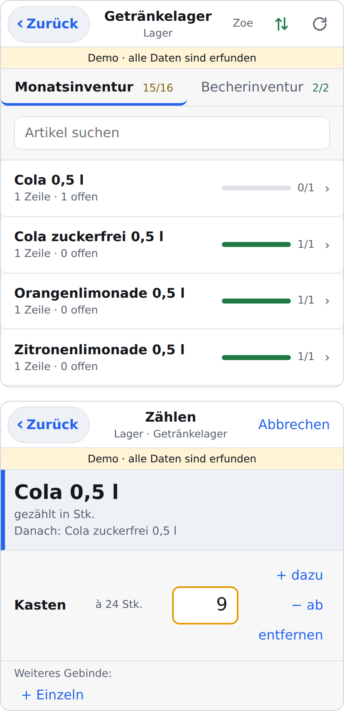
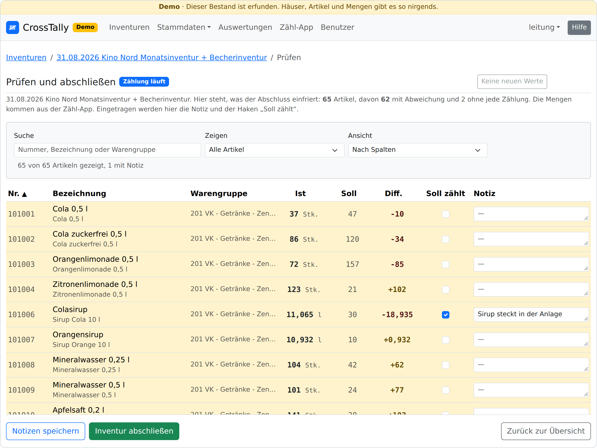

# CrossTally

*[English version](README.en.md)*

[](https://github.com/lennago/crosstally/actions/workflows/image.yml)
[](https://github.com/lennago/crosstally/actions/workflows/audit.yml)
[](https://github.com/lennago/crosstally/releases)
[](LICENSE)

Inventuren zählen, prüfen und festhalten. Gedacht ist es für Unternehmen
mit mehreren **Häusern**, also Standorten, die ihre Waren in einer
Warenwirtschaft führen. Häuser, Bereiche, Orte und Artikel sind Daten, nichts
davon steht im Code. Es passt überall, wo mehrere Standorte denselben
Artikelstamm getrennt pflegen. Ein Haus ohne Warenwirtschaft, etwa ein
Restaurant, führt eigene Artikel ohne Nummer und pflegt sein Soll von Hand.

Das erste unterstützte Format ist das von **Compeso WinTICKET**, einer Kassen-
und Warenwirtschaftssoftware für Kinos. Weitere Formate kommen als Modul dazu.

Die Anwendung ersetzt die Warenwirtschaft nicht. Bewertung, Buchung und die
verbindliche Differenz bleiben dort. Die Anwendung liefert, was beim Zählen
fehlt: eine Zähloberfläche fürs Handy, die auch im Lager ohne Netz arbeitet,
eine Prüfliste mit Soll, Ist und Differenz schon während der Zählung und am
Ende ein unveränderliches Ergebnis als PDF, von dem sich die Zahlen in die
Warenwirtschaft übertragen lassen.

**Stand:** Veröffentlicht wird über die
[Releases](https://github.com/lennago/crosstally/releases), angefangen mit 0.1.0.
Bis 1.0 kündigt sich ein Bruch nur im Changelog an, nicht an der ersten Stelle
der Nummer.

<p align="center">
  
  
</p>
<p align="center"><em>Links die Zähl-App im Getränkelager, rechts die Prüfliste
derselben Inventur, während noch gezählt wird. Beides stammt aus der Demo.</em></p>

## Was es kann

- **Zählen mit dem Handy:** eine installierbare Web-App (PWA) unter `/app/`,
  auf jedem Smartphone oder Tablet, ohne App-Store. Offline zuerst: Jede
  Eingabe landet auf dem Gerät und geht zum Server, sobald wieder Netz da ist.
  Gezählt wird Ort für Ort, in der Reihenfolge des Regals.
- **Gebinde und Waage:** Gebinde heißt die Packung, in der eine Ware kommt
  (Kasten, Karton, Sack). „9 Kästen à 20 und 9 einzelne“ oder „2750 g in der
  250-g-Schale“ sind je eine Eingabe. Umgerechnet wird auf dem Server, je Gefäß
  mit eigener Tara.
- **Ein Artikelstamm über alle Häuser:** Dieselbe Ware hat in jedem Haus eine
  andere Nummer, dieselbe Nummer meint je Haus etwas anderes. Die Anwendung
  führt deshalb den Artikel des Hauses (*Hausartikel*) und die Ware dahinter
  (*Ware*) getrennt und wertet über Häuser hinweg aus, auch mit einem Haus ohne
  Warenwirtschaft. Ist im selben Haus etwas doppelt angelegt, führt man die
  beiden zusammen: Einer bleibt, wie er ist, der andere wird ihm zugerechnet,
  samt Sollbestand.
- **Inventurarten als Reiter:** etwa Monats- und Jahresinventur oder eine
  eigene Zählung nur für Verbrauchsmaterial wie Becher und Tüten (im Kino die
  Becherinventur). Jeder Hausartikel gehört zu einer Art, eine Inventur zählt
  die gewählten, und die Zähl-App zeigt je Art einen Reiter.
- **Import aus der Warenwirtschaft:** der Artikelstamm je Haus, in zwei
  Schritten. Erst kommt ein Plan zum Durchsehen, dann das Schreiben. Heute im
  Format von WinTICKET, als xlsx oder csv. Der Sollbestand kommt als Datei zur
  einzelnen Inventur oder wird von Hand gepflegt.
- **Rezepturartikel:** Vorbereitete Ware, die es in keinem Artikelstamm gibt,
  etwa eine fertige Portion Nachos, wird als Portion gezählt und beim Abschluss
  auf ihre Zutaten verteilt.
- **Prüfen vor dem Abschluss:** Differenzen, Notizen je Artikel und Rückfragen
  zu dem, was die Zählung über die Stammdaten verrät (inaktiv, aber gezählt,
  oder erwartet, aber nirgends gefunden). Die Prüfliste steht auch in der
  Zähl-App. Kann eine Zählung nicht stimmen, setzt eine Führungskraft „Soll
  zählt“: Dann gilt beim Abschluss der Sollbestand als Ergebnis.
- **Differenz von Hand:** Ohne Datei mit dem Sollbestand trägt man je Artikel
  die Differenz ein, die die Warenwirtschaft zeigt, sobald die gezählten Mengen
  dort stehen. Das geht auf der Website und in der App.
- **Ergebnis als PDF** je Inventur, mit den Notizen, und eine Auswertung über
  Zeitraum und Häuser, gegliedert nach frei wählbaren Warenfamilien.
  Gegenläufige Differenzen derselben Ware zeigen, dass sie zwischen den Häusern
  gewandert ist.
- **Rollen:** Administratoren, Führungskräfte (Weboberfläche) und Zählende (nur
  die Zähl-App), jeweils Häusern und Inventuren zugeordnet. Neue Konten kommen per
  Einladungsmail und setzen ihr Passwort selbst. Anmelden geht auch mit einem
  Passkey (Gesicht, Finger oder PIN des Geräts), auf der Website wie in der App.
- **Deutsch und Englisch:** Jedes Konto wählt seine Sprache, für Weboberfläche,
  Verwaltung und Zähl-App. Artikel- und Hausnamen bleiben, wie sie eingetragen
  sind.
- **Außerdem:** verschlüsselte Backups aus der Oberfläche und per Skript,
  Hilfetexte zu jeder Seite, ein helles und ein dunkles Thema.

**Was es nicht kann:** Es gibt keine Schnittstelle zur Warenwirtschaft. Der
Austausch läuft über Dateien, und die gezählten Mengen werden dort von Hand
eingetragen. Einkauf, Wareneingang, Umlagerungen und Umsatzkennzahlen sind nicht
Teil der Anwendung.

## Wozu, wenn es WinTICKET gibt?

Compeso bietet selbst eine Warenwirtschaft mit Inventur und mobiler Zählung
sowie Dashboards, die mehrere Häuser gemeinsam auswerten. Diese Anwendung setzt
dort an, wo das in der Praxis nicht greift.

**Häuser, deren Stammdaten auseinandergelaufen sind.** Wer mehrere Häuser als
getrennte Compeso-Kunden führt, hat nach einigen Jahren selten einen
einheitlichen Artikelstamm. Dieselbe Ware steht unter verschiedenen Nummern, und
die Warengruppen sind je Haus anders geschnitten. Auswertungen über Häuser
setzen aber einheitliche Stammdaten voraus. Hier verknüpft eine gemeinsame Ware
die Artikel der Häuser, ohne dass in WinTICKET etwas umgestellt werden muss. Der
Import schlägt die Zuordnung vor, entschieden wird einmal. Gegliedert wird nach
eigenen *Warenfamilien*, unabhängig von den Warengruppen.

**Zählen aus einer Liste, ohne EANs oder Etiketten.** Die Zähl-App zeigt je Ort,
was dort erwartet wird, mit einem Vorschlagswert. Man geht die Liste von oben
nach unten durch, statt jede Packung zu suchen und zu scannen, und was fehlt,
bleibt sichtbar offen. Dafür genügt der Artikelstamm, den WinTICKET ohnehin
exportiert.

Was WinTICKET voraushat: Seine Inventur bucht direkt in die Warenwirtschaft.
Hier werden die Ergebnisse vom PDF in WinTICKET übertragen.

## Wie eine Inventur abläuft

1. **Stammdaten, einmalig:** Häuser mit Bereichen und Orten anlegen, je Haus den
   Artikelstamm importieren und je Ort die Zählliste zusammenstellen (welche
   Ware liegt hier üblicherweise, in welchem Gebinde).
2. **Vorbereitung:** die Inventur anlegen (erst die Inventurarten, dann ein Haus
   oder mehrere), Zählende zuordnen, den Sollbestand hochladen oder von Hand
   pflegen.
3. **Zählung:** „Zählen starten“ gibt die Inventur für die Zähl-App frei. Die
   Weboberfläche zeigt Fortschritt und Differenzen, gezählt wird nur in der App.
4. **Prüfen und abschließen:** die Prüfliste durchsehen, Rückfragen beantworten,
   abschließen. Das Ergebnis ist danach eingefroren, und das PDF speist sich
   daraus.

## Ausprobieren

Ein Befehl legt einen erfundenen Bestand an, an dem sich alles durchspielen
lässt: vier Häuser, vier Konten, ein Warenkatalog mit Zähllisten und 14
Inventuren an sieben Stichtagen, abgeschlossen, in der Zählung und in
Vorbereitung. Gebraucht wird, was unter „Entwickeln“ steht.

```bash
cd server
cp .env.example .env                     # SECRET_KEY und ADMIN_URL eintragen
uv sync && uv run manage.py migrate
uv run manage.py demo                    # baut den Bestand auf und druckt die Konten
(cd ../app && npm ci && npm run build)   # die Zähl-App, Django liefert sie unter /app/ aus
uv run manage.py runserver               # http://localhost:8000
```

Die Website liegt dann unter `http://localhost:8000`, die Zähl-App
unter `http://localhost:8000/app/`. Das Passwort der Konten druckt der
Befehl `demo`, am besten zählt man als `zaehler`. Für eine englische Oberfläche
steht `LANGUAGE_CODE=en` in der `.env`, dann entsteht auch die Demo englisch.

Die Demo schreibt in die Datenbank aus `DATABASE_URL` und weigert sich, wenn
dort schon ein eigener Bestand steht, und sei es ein einzelnes Konto. Was alles zu sehen ist und wie man ein Haus von Grund
auf aufsetzt, steht in [DEMO.md](DEMO.md).

## Aufbau

| Teil | Technik | Ort |
| --- | --- | --- |
| Weboberfläche und Verwaltung | Python 3.14, Django 6.1, Bootstrap 5.3, PostgreSQL | [server/](server/) |
| Schnittstelle der Zähl-App | Django REST Framework, JWT | [server/api/](server/api/) |
| Zähl-App (PWA) | Svelte 5, Vite, Dexie (IndexedDB) | [app/](app/) |
| Betrieb | ein Image (Django liefert die App mit aus), Caddy für TLS | [compose.yaml](compose.yaml), [Dockerfile](Dockerfile) |

Das Datenmodell steht als ER-Diagramm in
[inventur_datenmodell.mermaid](inventur_datenmodell.mermaid), auf Englisch in
[inventur_datenmodell.en.mermaid](inventur_datenmodell.en.mermaid).

## Betrieb mit Docker

Veröffentlichte Versionen liegen als Image unter `ghcr.io/lennago/crosstally`
(nur `linux/amd64`). Gebraucht werden:

- **Ein Rechner** mit Docker und dem Compose-Plugin (Version 2). Er darf klein
  sein: zwei Kerne, 2 GB Arbeitsspeicher und eine SSD genügen.
- **HTTPS.** Für die Zähl-App ist es zwingend, denn ohne sicheren Kontext gibt
  es keinen Service Worker, also weder Installation noch Offlinebetrieb. Mit
  einer eigenen Domain holt Caddy das Zertifikat selbst. Dafür muss der Name per
  DNS auf den Rechner zeigen, und die Ports 80 und 443 müssen aus dem Internet
  erreichbar sein (Firewall, Weiterleitung im Router). Steht der Rechner nur im
  internen Netz, nennt [DEPLOYMENT.md](DEPLOYMENT.md#das-zertifikat) die Wege.

```bash
# 1. Das Repo holen. Gebraucht werden daraus compose.yaml, Caddyfile und das
#    Backup-Skript, gebaut wird nichts.
git clone https://github.com/lennago/crosstally.git && cd crosstally

# 2. Die Umgebung ausfüllen, siehe die Tabelle unten.
cp .env.example .env

# 3. Der Ordner für die Backups gehört dem Benutzer des Containers (uid 1000).
mkdir -p backups && sudo chown 1000:1000 backups

# 4. Das Image holen und starten. '--no-build' ist wichtig: In der compose.yaml
#    steht auch eine Bauanleitung, und ohne die Angabe baut compose selbst.
docker compose pull
docker compose up -d --no-build

# 5. Das erste Konto ist ein Administrator. Alle weiteren entstehen in der Oberfläche.
docker compose exec web python manage.py createsuperuser
```

Die Datenbank wird beim Start von selbst migriert. Danach anmelden und die
Standorte unter **Stammdaten → Häuser und Orte** anlegen, je Haus den
Artikelstamm importieren. Die Zähl-App liegt unter `https://<adresse>/app/`.

### Was in die `.env` gehört

Die Vorlage erklärt jeden Wert. Diese gehören in jedem Betrieb hinein:

| Variable | Bedeutung |
| --- | --- |
| `SECRET_KEY` | **Pflicht.** Lang und zufällig, etwa aus `openssl rand -base64 48`. |
| `BACKUP_KEY` | **Pflicht.** Der Schlüssel, mit dem jedes Backup verschlüsselt wird, ebenso erzeugt. Eine Kopie gehört an einen Ort außerhalb des Rechners: Ohne ihn ist kein Backup mehr lesbar. |
| `POSTGRES_PASSWORD` | **Pflicht.** Das Passwort der Datenbank, ebenso erzeugt. Die Datenbank übernimmt es beim ersten Start. |
| `ADMIN_URL` | **Pflicht.** Der Pfad der Verwaltung (Django-Admin), ein eigener mit `/` am Ende, etwa `verwaltung-x7/`. Mit dem Platzhalter der Vorlage startet die Anwendung nicht. Ohne Anmeldung antwortet der Pfad mit 404: erst auf der Website anmelden, dann führt im Kontomenü der Eintrag „Verwaltung“ dorthin. Unter `/admin/` wartet nur ein Köder. |
| `SITE_ADDRESS` | **Pflicht.** Die eigene Domain, etwa `crosstally.example.de`. Caddy holt das Zertifikat dafür selbst. `:80` gehört nur hinein, wenn davor schon etwas TLS macht. |
| `EXTRA_ALLOWED_HOSTS` | **Pflicht.** Derselbe Name. Ohne ihn antwortet die Anwendung mit „Bad Request“. |
| `CSRF_TRUSTED_ORIGINS` | Empfohlen: dieselbe Adresse mit `https://` davor. Hinter Caddy gehen Formulare auch ohne. Nötig ist der Eintrag erst, wenn ein Proxy unterwegs Schema oder Namen ändert. |
| `VERSION` | Welches Image läuft, am besten eine feste Nummer wie `0.1.0`. Dann entscheidet der Eintrag, was läuft, nicht der Zeitpunkt des letzten `pull`. Die Vorlage nennt die jüngste Version. |

Die übrigen Werte haben Vorgaben: ein Mailserver für Einladungen und „Passwort
vergessen?“, ein Proxy vor Caddy, HSTS, Sprache und Zeitzone, die Zahl der
Arbeiter. Sie stehen mit allen Einzelheiten in
[DEPLOYMENT.md](DEPLOYMENT.md#alle-werte-der-env), ebenso ein eigener Proxy
statt Caddy und ein Fork mit eigenem Image. Name, Logo, Betreiber, Impressum,
Datenschutztext und die Texte der Mails gehören nicht in die `.env`. Sie stehen
in der Verwaltung (siehe unten).

### Aktualisieren

```bash
./server/bin/backup.sh             # vorher ein Backup, denn Migrationen laufen beim Start
git pull                           # compose.yaml und Caddyfile können sich mitändern
# VERSION in der .env anheben, dann:
docker compose pull
docker compose up -d --no-build
```

Ausgerollt wird nicht, solange eine Zählung läuft. Was sich zwischen den
Versionen geändert hat, steht bei den
[Releases](https://github.com/lennago/crosstally/releases) und im Changelog
(`CHANGELOG.md`). Ein Bruch, der im
Betrieb Handarbeit verlangt, steht dort oben und hervorgehoben. Welche Version
läuft, zeigt das Kontomenü ganz unten, in der Weboberfläche wie in der Zähl-App.
Die Zähl-App auf den Handys bemerkt eine neue Version von selbst und bietet das
Neuladen an.

**Mehr zum Betrieb** steht in [DEPLOYMENT.md](DEPLOYMENT.md): alle Werte der
Datei `.env`, das Zertifikat ohne öffentliche Erreichbarkeit, Backups und
Zurückspielen, auch auf einem neuen Rechner, der Rückweg nach einem Update und
was leicht schiefgeht.

## Betreiber und Datenschutz

Im Fuß jeder Seite steht, wer die Anwendung betreibt, daneben ein Verweis auf
den Datenschutz (`/datenschutz/`, auf einem englischen Server `/privacy/`).
Diese Seite erklärt den eigenen Leuten, was über sie gespeichert wird und wie
lange. Sie ist ohne Anmeldung zu lesen, denn gerade die Zählenden sehen von der
Weboberfläche sonst nichts. Betreiber, Kontakt, ein Impressum, eine Adresse für
Rückmeldungen und den Datenschutztext trägt ein Administrator in der Verwaltung
ein, in derselben Fassung wie das Logo. Der mitgelieferte Text ist ein Anfang,
keine Rechtsberatung. Es gibt weder Tracking noch Statistik, die Seite lädt
nichts von fremden Servern, und eine Cookie-Abfrage braucht es nicht.
Einzelheiten stehen in [DEPLOYMENT.md](DEPLOYMENT.md#betreiber-und-datenschutz).

## Ein eigenes Logo

Das mitgelieferte Logo ist ein Platzhalter (eine Strichliste aus reiner
Geometrie) und zum Austauschen gedacht. Der Austausch läuft über die
Verwaltung, nicht über einen Fork:

1. Als Administrator anmelden.
2. In der Verwaltung **Organisation → Erscheinungsbild und Betreiber** öffnen.
   Dort liegt die Fassung **Standard**: das ausgelieferte Logo, kein Betreiber,
   kein Impressum, der mitgelieferte Datenschutztext. Sie lässt sich nicht
   ändern, nur kopieren: Zeile anhaken, Aktion **Kopie anlegen**.
3. Die Kopie öffnen, ihr einen Namen geben und ein **quadratisches PNG**
   hochladen, mindestens 512 x 512 Pixel. Dort stehen auch der Name der
   Anwendung, Betreiber, Impressum und Datenschutztext.
4. In der Liste die Kopie anhaken und **Als aktive Fassung wählen**.

Daraus entstehen alle übrigen Größen: das Logo der Navigationsleiste, das Bild
im Browsertab und die Icons für den Startbildschirm. Es braucht kein eigenes
Image und keinen Fork. Es darf beliebig viele Fassungen geben, genau eine ist
aktiv. Zurück zum Ausgelieferten heißt: den Standard wählen. Der Name im Feld
„Name der Anwendung“ steht in der Leiste, im Browsertab und am Icon der
Zähl-App, leer heißt er „CrossTally“.

Hochgeladen wird nur PNG, höchstens 4096 Pixel und 2 MB. Das Logo liegt in der
Datenbank und wandert damit in jedes Backup. Auf Geräten, auf denen die App
schon installiert ist, bleibt das alte Icon meist bis zur Neuinstallation. Mehr
dazu steht in [DEPLOYMENT.md](DEPLOYMENT.md#logo-und-name-im-einzelnen).

## Entwickeln

Entwickelt wird ohne Docker, mit SQLite, unter Linux oder macOS (unter Windows
in WSL). Gebraucht werden:

- [uv](https://docs.astral.sh/uv/), das Python 3.14 selbst mitbringt.
- Node 24 oder neuer (CI und Image nehmen 26).
- **Pango und HarfBuzz** für die PDFs, auch in den Tests. Unter Debian und
  Ubuntu: `sudo apt install libpango-1.0-0 libpangoft2-1.0-0 libharfbuzz-subset0`,
  unter macOS: `brew install pango`.
- **gettext**, nur zum Ändern von Texten (`apt install gettext`, `brew install gettext`).

```bash
# Server
cd server
cp .env.example .env                   # SECRET_KEY und ADMIN_URL eintragen
uv sync                                # legt .venv aus uv.lock an
uv run manage.py migrate
uv run manage.py createsuperuser       # oder die Demo, siehe „Ausprobieren“
uv run manage.py runserver             # http://localhost:8000

# Zähl-App, in einem zweiten Terminal aus dem Ordner des Repos
cd app
npm ci
npm run dev                            # http://localhost:5173/app/, die API geht an :8000
npm run build                          # statt dev: nach server/pwa/, Django zeigt sie unter /app/
```

Mit `npm run dev` meldet man sich in der App mit Benutzername und Passwort an.
Die Übernahme der Anmeldung von der Website setzt dieselbe Herkunft voraus und
greift nur bei der gebauten App unter `/app/`.

Die Prüfungen, die auch die CI fährt:

```bash
# aus server/, die Gruppe test bringt tblib und coverage mit
uv run --group test manage.py test --parallel auto  # rund 4200 Tests, etwa 25 Sekunden
uv run ruff check . && uv run ruff format --check .
uv run pyright                         # null Meldungen ist die Schranke
uv run manage.py makemigrations --check --dry-run
uv run --group test coverage run manage.py test --parallel auto  # mit Abdeckung
uv run --group test coverage combine && uv run --group test coverage report  # unter 95 % rot

# aus app/
npm test                               # Vitest
npm run test:coverage                  # Vitest mit Abdeckung, unter den Schwellen rot
npx playwright install chromium        # einmalig, unter Linux mit --with-deps
npm run test:e2e                       # Playwright, einmal durch die App in Chromium
npm run format:check                   # Prettier, auch über server/static/js
```

`npm run test:e2e` baut die App, startet ein Django mit dem Demo-Bestand auf
einer Wegwerf-Datenbank (`app/bin/e2e-server.sh`) und klickt in Chromium durch
Zähl-App und Website, auch auf dem kleinsten Telefon im Dunkeln. Der Server hört auf Port 8123. Ist der belegt, setzt
man `E2E_PORT=<port>`, denn außerhalb der CI prüft Playwright sonst gegen das,
was dort schon antwortet. In VS Code zeigen die Erweiterungen für Python,
Vitest und Playwright alle drei Testsätze im Testing-Panel. Die
Python-Erweiterung braucht dafür in `.vscode/settings.json` den
Wert `python.testing.cwd` auf `server` und, über `python.envFile`, die
Variable `MANAGE_PY_PATH` mit dem absoluten Pfad von `server/manage.py`.

Die Bilder oben in dieser README entstehen aus der Demo. Nach einer sichtbaren
Änderung an der Oberfläche macht `npm run screenshots` sie neu, auf Deutsch und
auf Englisch. Wie die Tests braucht es dafür Chromium. Die Bilder liegen
in `docs/screenshots/` und gehören mit in den Commit.

Lokal laufen die Tests gegen SQLite, in der CI gegen PostgreSQL, weil der
Betrieb darauf läuft. Ein Unterschied ist sichtbar: Die Suche über Waren und
Hausartikel verzeiht Tippfehler nur auf PostgreSQL (Erweiterung `pg_trgm`, die
Migration legt sie an). Unter SQLite findet sie, was den Begriff enthält, und
die Tests dazu werden übersprungen.

Mit `DEBUG=True` steht jede Mail in der Konsole von `runserver`, auch wenn ein
Mailserver eingetragen ist. Wer sie so sehen will, wie sie ankommt, startet den
Stapel mit Docker und lässt Mailpit daneben laufen, siehe
[DEPLOYMENT.md](DEPLOYMENT.md#zum-ausprobieren-ohne-domain).

Bootstrap, Tom Select und SortableJS liegen fertig
unter `server/static/vendor/`, damit die Weboberfläche ohne CDN auskommt. Eine
neue Version holt `server/bin/vendor.sh`, samt Lizenztext.

### Den mitgelieferten Platzhalter ersetzen

Für den Betrieb ist das nicht nötig: Dort wird das Logo hochgeladen. Wer den
Platzhalter im Repo selbst austauschen will, ersetzt zwei SVG-Dateien und
erzeugt die PNG daraus neu.

| Datei | Wofür | Form |
| --- | --- | --- |
| [server/static/logo.svg](server/static/logo.svg) | Navigationsleiste, Browsertab, Favicon | wie gezeichnet, mit eigener Rundung |
| [server/static/logo-maskable.svg](server/static/logo-maskable.svg) | Startbildschirm von Android und iOS | **randfüllend**, das Motiv verkleinert in der Mitte (der Platzhalter nutzt 85 %) |

```bash
cd app
npm ci
npx playwright install chromium   # gerendert wird mit Chromium
npm run icons                     # Favicon, Apple-Icon, 192/512 in beiden Formen
```

Die erzeugten PNG liegen im Repo (`server/static/`
und `app/public/icons/`), damit der Build selbst ohne Chromium auskommt. Sie
gehören also mit in den Commit.

## Mitwirken

Fehlerberichte und Vorschläge sind als Issue willkommen, Änderungen als Pull
Request auf `main`. Vor dem ersten Commit richtet `uvx pre-commit install` den
Hook aus `.pre-commit-config.yaml` ein (pre-commit steht in keiner Gruppe, uvx
holt es). Er lässt gitleaks über das Staging laufen, damit kein Geheimnis ins
öffentliche Repo gelangt. Der Workflow `secrets.yml` ist nur das Netz dahinter.
Vier Dinge vorab:

- **Das Grundgerüst ist deutsch, die Kommentare sind englisch.** Modelle,
  Felder, URL-Namen und die Ausgangstexte der Oberfläche heißen deutsch, und
  das bleibt so. Alles, was sich an Entwickler richtet (Kommentare, Docstrings,
  Workflows, Betriebsdateien), steht auf Englisch. Wer beiträgt, muss kein
  Deutsch schreiben: Neue Klassen, Funktionen und Variablen dürfen englisch
  heißen, solange sie nicht an ein deutsches Modell oder Feld anknüpfen. Die
  Zähl-App unter `app/` ist durchgehend englisch benannt. Deutsch sind dort
  nur die Oberflächentexte und die Felder, die von der API kommen.
  Commit-Nachrichten in beiden Sprachen sind willkommen.
- **Jede Oberfläche gibt es in beiden Sprachen.** Ein neuer Text braucht seine
  deutsche und seine englische Fassung, bevor er gemerged wird. Je nachdem, wo
  er steht, gehört sie nach `server/locale/`, nach `app/src/texts.js` oder
  nach `server/templates/help/`. Wie das geht, steht in
  [DEPLOYMENT.md](DEPLOYMENT.md#übersetzungen). Wer nur eine der beiden
  Sprachen sicher schreibt, liefert diese und sagt es im Pull Request.
- **Der Titel des Pull Requests folgt den [Conventional
  Commits](https://www.conventionalcommits.org/de/)** (`feat:`, `fix:`, `docs:`
  …). Er wird zur Commit-Nachricht, und release-please liest daraus die nächste
  Version und das Changelog. `CHANGELOG.md` und `version.txt` deshalb nicht von
  Hand ändern.
- **Zu jeder Verhaltensänderung gehört ein Test.** Kein Inline-Skript und
  kein `<style>` in den Vorlagen: Die Content-Security-Policy sperrt beides.

Die Hilfetexte der Weboberfläche lassen sich ohne Programmierkenntnisse
ändern. Wie das geht, steht in
[server/templates/help/README.md](server/templates/help/README.md). Sie stehen
je Sprache in einem eigenen Ordner.

## Rückmeldungen und Wünsche

Wer die Anwendung im eigenen Betrieb einsetzt oder es vorhat, ist mit
Verbesserungsvorschlägen und Ideen für neue Funktionen willkommen, am
einfachsten als [Issue](https://github.com/lennago/crosstally/issues). Wer
lieber nicht öffentlich schreibt, erreicht mich per Mail
unter [lennago.github@pm.me](mailto:lennago.github@pm.me). Eine Sicherheitslücke
bitte nur per Mail melden, nicht als Issue. Ich freue mich auch über eine
Nachricht, wenn die Anwendung einfach läuft und nichts fehlt.

**Gesucht: WinTICKET in einer anderen Sprache.** Der Import liest bisher nur den
deutschen Artikelstamm. Unter jedem Artikel steht dort, wie die Ware gekauft
wird („gekauft in Karton zu 24 Stück“), und daraus liest der Import Gebinde und
Menge. Wer WinTICKET auf Englisch oder in einer anderen Sprache nutzt, hilft am
meisten mit einem Export mit erfundenen oder unkenntlich gemachten Artikeln.
Ebenso gern: Wünsche nach einer weiteren Sprache der Oberfläche.

## Lizenz und Marken

Das Projekt steht unter der **MIT-Lizenz**. Der Text liegt in
[LICENSE](LICENSE). Benutzen, verändern, weitergeben und in eigene Produkte
übernehmen ist erlaubt, auch geschlossen und kommerziell, solange der
Lizenztext mitgeht.

Mitgeliefert werden auch fremde Bibliotheken unter ihren eigenen Lizenzen,
überwiegend MIT, BSD und Apache-2.0, einzelne unter LGPL-3.0, MPL-1.1 und OFL.
Welche das sind und wo ihre Lizenztexte liegen, steht in
[THIRD_PARTY_NOTICES.md](THIRD_PARTY_NOTICES.md). Im Image liegen die Texte bei.

**Ohne Gewährleistung und ohne Zusage.** Das Projekt wird in freier Zeit
gepflegt. Issues und Pull Requests werden gelesen, aber es gibt keinen
Anspruch auf Antwort, Fehlerbehebung, Sicherheitsupdates oder Unterstützung
beim Betrieb. Wer die Anwendung einsetzt, prüft sie selbst und hält sie selbst
aktuell.

„Compeso“ und „WinTICKET“ sind Marken ihrer jeweiligen Inhaber. Dieses Projekt
ist unabhängig entstanden und steht in keiner Verbindung zum Hersteller. Es
liest ausschließlich Dateien, die WinTICKET selbst exportiert, und schreibt
nichts dorthin zurück.
